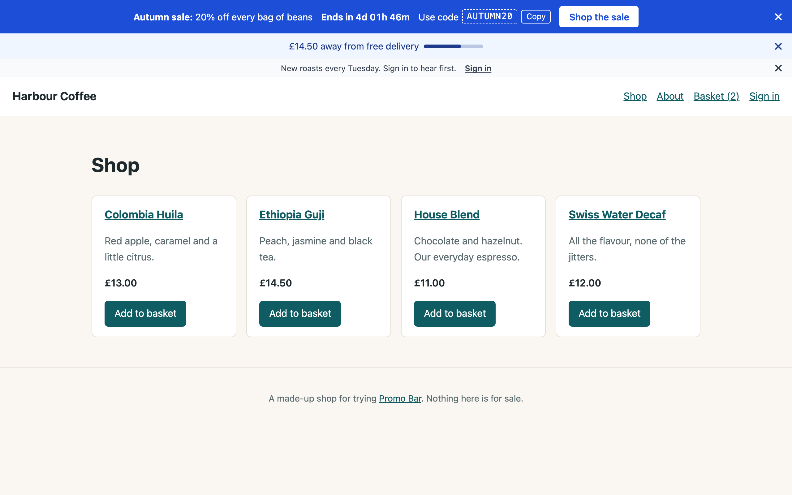

# Cargo

With [Cargo](https://builtwithcargo.dev) 1.15 or later installed, bars can show how far the basket is from free delivery, and take discount codes from Cargo's discounts. Nothing changes without Cargo: these fields aren't in the form.

## Free delivery progress

On a bar's **Content** tab, turn on **Show free delivery progress** and choose where free delivery starts:

- **An amount**: the basket total for free delivery, in the site's currency.
- **A Cargo free shipping discount**: an automatic Free Shipping discount (no code) with a minimum order value. The bar uses that value, and ends when the discount does (its end date, or when it's used up or deleted).

Visitors with something in their basket see:

> £12.00 away from free delivery ▬▬▬▬▭▭

and once they're there, **You've unlocked free delivery**. Both lines can be changed for each bar, or for every bar in the settings (**Wording**). `:remaining` is the amount still to spend.

Visitors without a basket, or without JavaScript, see the bar's message. Put `:threshold` in it for the amount:

> Free UK delivery on orders over :threshold

The basket's total is Cargo's subtotal: what Cargo checks a discount's minimum order value against. The progress doesn't know about a free shipping discount's other conditions (products, customers).

On cached pages, the progress is fetched from `/!/promo-bar/state` after the page loads; it never makes a basket for visitors without one. Without static caching, it's drawn on the server. If your basket changes without a page load (an AJAX cart), call `PromoBar.refresh()` afterwards (see [JavaScript](javascript.md)).

## Codes from Cargo's discounts

Set **Discount code** to **From a Cargo discount** and choose a discount with a code. The bar shows its code with a Copy button, and only while the discount can be used: after its start date, before its end date, and not used up. When it can't, the bar isn't shown (and cached pages are cleared when that changes).

## Multisite shops

Amounts are shown in the current site's currency. A bar with an amount threshold is in one currency, so on a shop with several currencies, give each site its own bar (**Where → Sites**).
