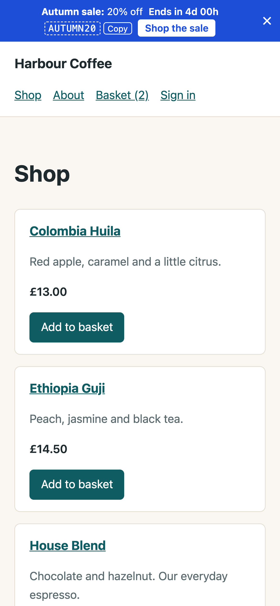

# The demo shop

Harbour Coffee is a small made-up coffee shop, built with Cargo and Promo Bar, to try every feature on.



It has five bars:

| Bar | Shows |
| --- | --- |
| Autumn sale | A countdown, a code with a Copy button, and a button, with a shorter message on phones. Solid. |
| Free delivery | Progress towards free delivery from a Cargo free shipping discount, on the shop and basket pages only. Subtle. |
| Members early access | Only for signed-in members (the Members user group). Dark. |
| Newsletter | Only for guests; comes back 30 days after it's dismissed. Minimal. |
| Black Friday | Scheduled for 27 November, so not on the site until then. Gradient. |

## Running it

```bash
git clone https://github.com/1994limited/promo-bar-statamic-demo.git
cd promo-bar-statamic-demo
composer install
cp .env.example .env
php artisan key:generate
php artisan demo:users
php artisan demo:seed
php artisan serve
```

`demo:users` makes `admin@example.com` (the Control Panel) and `ada@example.com` (a member), both with the password `password`. It only runs with `APP_ENV=local`. `demo:seed` puts the bars back as above.

Turn on static caching (`STATAMIC_STATIC_CACHING_STRATEGY=half` in `.env`) to see the bars working on cached pages.
